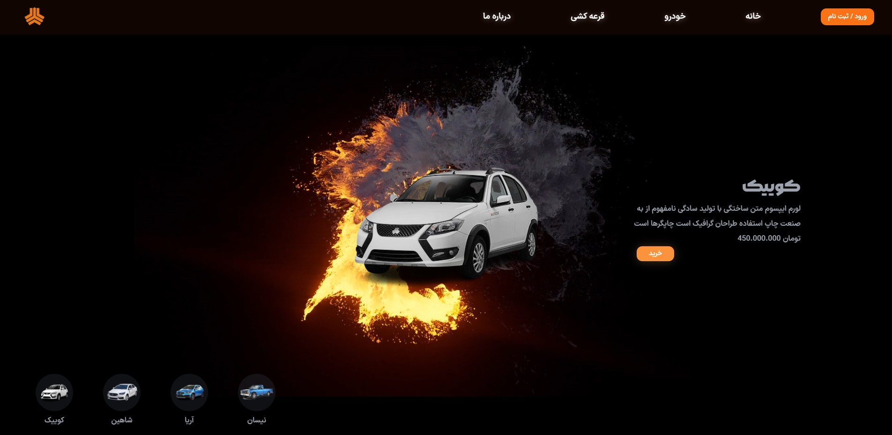

<p align="center">
  
</p>

# 🚗 Saipa Website Redesign Concept

## 🚧 Project Status: Completed (Concept Project)

Saipa Website Redesign is a frontend concept project created to explore modern web design, smooth animations, and interactive user experiences.

This project is not an official Saipa website. It is a personal frontend experiment where I redesigned the interface with a modern approach and focused on creating a more engaging user experience.

The goal of this project was to practice advanced frontend development techniques, animation systems, and building professional interfaces inspired by real-world websites.

---

## ✨ Project Goals

- 🎨 Redesigning a real-world website with a modern UI approach
- ⚡ Creating smooth and engaging animations
- 📱 Building a responsive frontend experience
- 🧩 Improving frontend architecture and component development
- 🚀 Exploring advanced animation techniques for production websites

---

## 🛠️ Tech Stack

<div align="center">
  
  
  
</div>

### 🎬 Animation & 3D Libraries

- 🎬 **Framer Motion** — Smooth UI animations
- ⚡ **GSAP** — Advanced animation sequences
- 🧊 **Three.js** — 3D graphics for the web

---

## 🚀 Getting Started

### Installation

```bash
git clone https://github.com/Arsham-369-Ghaderi/Saipa-Redesign.git

cd Saipa-Redesign

npm install

npm run dev
